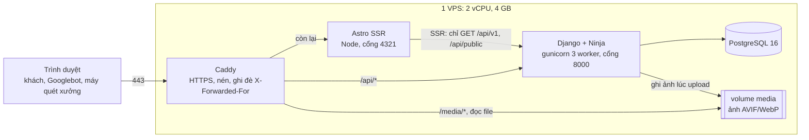

# Kiến trúc hệ thống Quế Văn Yên: tổng quan

Trạng thái: **bản trình sếp duyệt** (task #63; mục 6 cập nhật ở task #68). Ngày viết: 21/11/2026. Chưa có dòng code nào; sếp duyệt bộ tài liệu này xong thì đội mới dựng khung code.

Bộ tài liệu kiến trúc gồm 4 file:

| File | Nội dung | Người viết |
| --- | --- | --- |
| `README.md` (file này) | Tổng quan, cấu trúc repo, quy ước code chung, bảng đối chiếu yêu cầu, điểm cần thống nhất, các câu sếp đã chốt | Huy4 |
| [backend.md](backend.md) | Django + Django Ninja: chia app, API, xác thực và phân quyền, IP và giới hạn tần suất, PostgreSQL và migration, test | Minh2 |
| [frontend-seo.md](frontend-seo.md) | Astro: render và cache, JS, CSS, ảnh, gọi API, SEO, Google Ads và Consent Mode v2, đo Lighthouse | Huy4 |
| [van-hanh.md](van-hanh.md) | Docker compose, Caddy, biến môi trường, sao lưu, log, Makefile, CI/CD, deploy 1 VPS | Lan3 |

Căn cứ nghiệp vụ: [thiet-ke-chi-tiet.md](../thiet-ke-chi-tiet.md) (viết tắt **TK**), [tom-tat.md](../tom-tat.md), [lo-trinh-chuyen-doi-so.md](../lo-trinh-chuyen-doi-so.md), mockup đã duyệt [ban-chinh.html](../mockup/ban-chinh.html) và [ban-xem-truoc.html](../mockup/de-xuat/ban-xem-truoc.html).

Nên đọc theo thứ tự: mục 1 và 4 của file này, rồi mục 9 của backend.md và mục 12 của frontend-seo.md (các chỗ lệch so với TK, sếp để đội tự quyết ở #773), cuối cùng là mục 6 và 7 của file này.

---

## 1. Tổng quan

### 1.1 Sơ đồ



Hình ASCII cùng nội dung có ở [van-hanh.md](van-hanh.md) mục 1.

### 1.2 Những điểm chính

| Chủ đề | Chốt | Chi tiết ở |
| --- | --- | --- |
| Một tên miền, một origin | Website công khai, trang `/q/<serial>`, app nội bộ `/quan-ly/…` và API `/api/*` chung một tên miền. Cookie phiên `SameSite=Lax`, không cần CORS | van-hanh.md 1; frontend-seo.md 1.1 |
| Backend | Django 5.2 LTS, Python 3.13, Django Ninja, 5 app (gồm `core` dùng chung và 4 app theo phân hệ) phụ thuộc một chiều `core ← accounts ← catalog ← operations ← website` | backend.md 0, 1 |
| Frontend | Một project Astro (adapter Node, `output: 'server'`), Tailwind v4 + daisyUI 5, hai file CSS `site.css` và `admin.css` | frontend-seo.md 1, 4 |
| Contract giữa hai bên | Hai file OpenAPI `backend/openapi/v1.json` và `public.json` có commit, frontend sinh kiểu TS bằng `openapi-typescript` | backend.md 3.4; frontend-seo.md 5.4 |
| Đường ghi dữ liệu | Chỉ trình duyệt ghi, gọi thẳng `/api/v1` qua Caddy kèm `X-CSRFToken`. Astro SSR chỉ đọc (GET) | backend.md 4.2; frontend-seo.md 5.1 |
| Phân quyền | Kiểm ở API, mặc định chỉ OWNER, route mở cho xưởng phải khai `ANY_STAFF`, WORKSHOP có schema riêng không có trường giá | backend.md 4.3 |
| IP khách | Caddy ghi đè `X-Forwarded-For`, Astro chuyển nguyên, Django chỉ tin khi request đến từ subnet compose và duyệt từ phải sang trái. IP chỉ dùng để throttle và băm, không lưu | backend.md 5.1; van-hanh.md 3; frontend-seo.md 5.2 |
| Dữ liệu | PostgreSQL 16, migration có phiên bản chạy tự động ở entrypoint, sao lưu đêm 23:00 giữ 30 bản ra ngoài VPS | backend.md 6; van-hanh.md 5, 6 |
| Deploy | CI build image, đẩy GHCR, VPS pull qua SSH theo tag SHA. Quay lui là chạy lại tag cũ | van-hanh.md 9.2 |
| Không thêm | Redis, Celery, DRF, JS framework ở trang công khai, CDN, cache ở Caddy (chờ có số liệu) | backend.md 0; frontend-seo.md 2, 3 |

### 1.3 Dịch vụ chạy trên VPS

| Dịch vụ | Image | RAM giới hạn (prod) | Mở ra ngoài |
| --- | --- | --- | --- |
| caddy | `caddy:2` | 128 MB | 80, 443 |
| frontend | build từ `deploy/frontend.Dockerfile` | 384 MB | không |
| backend | build từ `deploy/backend.Dockerfile` | 768 MB | không |
| postgres | `postgres:16` | 1 GB | không |

Tổng prod khoảng 2,3 GB. Nếu staging chạy chung VPS thì tổng khoảng 3,3 GB, sát giới hạn; sếp đã chọn phương án này, staging chỉ bật khi cần thử (mục 7, câu 3).

---

## 2. Cấu trúc monorepo

```
vyc/                          # gốc repo, git nhánh main
├─ backend/                   # Django (backend.md 1.1)
│  ├─ pyproject.toml, uv.lock, .python-version, manage.py, conftest.py
│  ├─ openapi/                # v1.json, public.json: sinh tự động, có commit
│  ├─ config/                 # settings, urls, api (hai NinjaAPI), wsgi
│  ├─ core/  accounts/  catalog/  operations/  website/
│  └─ tests/integration/      # test theo mã AC của TK mục 12
├─ frontend/                  # Astro (frontend-seo.md 1)
│  ├─ astro.config.mjs, package.json, pnpm-lock.yaml, tsconfig.json, biome.json, lighthouserc.cjs
│  ├─ public/  scripts/gen-api.mjs
│  └─ src/                    # middleware, layouts, components/{site,admin}, scripts/admin,
│                             # lib/ (lib/api/*.d.ts sinh từ OpenAPI), pages/, content/, styles/
├─ deploy/                    # van-hanh.md 2
│  ├─ compose.yml, compose.dev.yml, compose.prod.yml, compose.ci.yml
│  ├─ caddy/Caddyfile, backend.Dockerfile, frontend.Dockerfile, backend-entrypoint.sh, deploy.sh
│  ├─ backup/ (backup.sh, restore.sh, collect-logs.sh, crontab.example), logrotate/vyc
│  ├─ env/.env.example        # chỉ tên biến và giá trị giả
│  └─ README.md               # hướng dẫn sếp dựng VPS lần đầu
├─ docs/
│  ├─ kien-truc/              # 4 file kiến trúc này
│  ├─ mockup/                 # mockup đã duyệt, KHÔNG sửa
│  ├─ _tools/                 # công cụ trích tài liệu; _tools/tmp/ không commit
│  └─ thiet-ke-chi-tiet.md, tom-tat.md, lo-trinh-chuyen-doi-so.md
├─ .github/
│  ├─ workflows/ci.yml        # mỗi PR và push main (van-hanh.md 9.1)
│  ├─ workflows/deploy.yml    # main → staging, tag v* → prod (van-hanh.md 9.2)
│  └─ dependabot.yml          # action, pip, pnpm, Docker base
├─ scripts/check-budget.mjs   # job budget: kiểm tĩnh dist/ (frontend-seo.md 8.2)
├─ Makefile                   # lệnh chung (van-hanh.md 8)
├─ .gitignore                 # bổ sung theo van-hanh.md 10
├─ .proteam/                  # trạng thái đội: brief, decisions, notes (evidence/, tasks/ không commit)
├─ Thiết kế chi tiết – Hệ thống Quế Văn Yên.docx    # file gốc, KHÔNG sửa (bản Markdown: docs/thiet-ke-chi-tiet.md)
└─ Lộ trình chuyển đổi số – Quế Văn Yên.docx        # file gốc, KHÔNG sửa (bản Markdown: docs/lo-trinh-chuyen-doi-so.md)
```

Cấu hình Lighthouse CI là `frontend/lighthouserc.cjs`, cạnh `@lhci/cli` trong `frontend/package.json` (đã thống nhất, điểm T1 ở mục 6).

Hai file docx gốc ở gốc repo (hai dòng cuối của cây) giữ nguyên, không sửa (quy ước dự án).

Quy tắc ranh giới:

- `backend/` và `frontend/` không import chéo nhau. Chỗ nối duy nhất là `backend/openapi/*.json`, frontend chỉ đọc hai file này lúc `pnpm gen:api`.
- Trong `backend/`, chiều import do import-linter chặn (backend.md 1.3). Trong `frontend/`, `site` và `admin` không import lẫn nhau, do Biome `noRestrictedImports` chặn (frontend-seo.md 9).
- `deploy/` không chứa secret. File `.env.*` thật chỉ nằm trên VPS và máy dev.

---

## 3. Quy ước code chung

Mỗi phía có quy ước riêng chi tiết hơn: backend.md 2 và 7, frontend-seo.md 9 và 10, van-hanh.md 11. Mục này là phần chung cho cả repo; chỗ nào tài liệu con nói khác thì theo mục này, và chỗ lệch được ghi ở mục 6.

### 3.1 Ngôn ngữ

| Thứ | Ngôn ngữ | Ví dụ |
| --- | --- | --- |
| Tên biến, hàm, lớp, file code, tên bảng, cột, trường JSON, mã lỗi | **Tiếng Anh** | `material_lot`, `add_material_lot()`, `LOT_GENERAL_STREAM` |
| Thuật ngữ nghiệp vụ trong tên code | Tiếng Anh theo bảng thuật ngữ TK mục 1, không tự dịch lại | `receipt` (phiếu nhập), `production_order` (lệnh SX), `serial` (mã tem) |
| Comment, docstring | Tiếng Việt hoặc tiếng Anh, mỗi file một thứ | |
| Chữ hiển thị cho người dùng, `message` của lỗi API | **Tiếng Việt** có dấu | `"Lô hàng chung, chỉ dùng xuất bán quế khô"` |
| URL trang (route Astro) và tên file trong `src/pages/` | Tiếng Việt **không dấu**, gạch nối | `/san-pham`, `/quan-ly/nhap-hang`, `pages/san-pham/[slug].astro` |
| Đường dẫn API | Tiếng Anh, giữ đúng TK mục 9 | `/api/v1/material-lots` |
| Tài liệu trong `docs/`, mô tả PR | Tiếng Việt | |

Ngoại lệ duy nhất cho chữ tiếng Việt trong tên code là route và slug nội dung, vì chúng là URL khách nhìn thấy. Module trong `src/lib/`, `src/scripts/` vẫn đặt tên tiếng Anh (điểm T9 ở mục 6).

### 3.2 Đặt tên

| Phạm vi | Quy ước |
| --- | --- |
| Python | Theo ruff: module, hàm, biến `snake_case`; lớp `PascalCase`; hằng `UPPER_SNAKE`. Service là hàm module, tham số keyword-only (backend.md 2) |
| Model Django | Lớp số ít `MaterialLot`, `Meta.db_table` giữ đúng tên bảng TK mục 4 |
| Schema Ninja | `<Entity>In`, `<Entity>Patch`, `<Entity>Out` (WORKSHOP), `<Entity>OwnerOut` (thêm trường giá), `Public<Entity>Out` (DTO công khai) |
| Đường dẫn API | Danh từ số nhiều, `kebab-case`, theo TK mục 9: `/production-orders/{id}/start` |
| Trường JSON | `snake_case`, trùng tên cột. Tiền là số nguyên VND; cân và gram là chuỗi thập phân `"120.50"`; thời điểm ISO 8601 UTC; ngày `YYYY-MM-DD` (backend.md 3.1) |
| Mã lỗi | `UPPER_SNAKE` nêu đúng việc sai; `details.rule` là mã BR (backend.md 3.2) |
| Test | Tên theo mã BR hoặc AC: `test_br08_rejects_general_lot`, `tests/integration/test_ac01_…py` (backend.md 7.1) |
| TypeScript | Biến, hàm `camelCase`; kiểu `PascalCase`; component `PascalCase.astro`; module `kebab-case.ts` (frontend-seo.md 10) |
| Biến môi trường | `UPPER_SNAKE`, nhóm theo tiền tố `DJANGO_`, `POSTGRES_`, `STAGING_`, `BACKUP_`. Không dùng tiền tố `PUBLIC_` của Vite (frontend-seo.md 5.1) |

### 3.3 Nhánh, commit, phát hành

- **Nhánh chính `main`**, luôn xanh CI và deploy được lên staging. Remote `origin` là `KevinDodv/vyc-project`. **Đội không push**: agent làm trên nhánh làm việc ở máy, sếp tự push và mở PR.
- **Nhánh làm việc** tách từ `main`, sống ngắn (vài ngày): `<loại>/<số task>-<mô tả ngắn không dấu>`, ví dụ `feat/63-khung-backend`, `fix/71-khoa-dang-nhap`. `<loại>` là một trong `feat`, `fix`, `docs`, `refactor`, `test`, `chore`, `ci`, `deploy`.
- **Commit**: dòng đầu `<loại>(<phạm vi>): <mô tả tiếng Việt>`, tối đa 72 ký tự. `<phạm vi>` là `backend`, `frontend`, `deploy`, `docs` hoặc tên app (`catalog`, `operations`). Ví dụ `feat(operations): thêm phiếu nhập theo BR-03`. Tiền tố tiếng Anh để công cụ lọc và Dependabot đọc được; mô tả tiếng Việt để sếp đọc lịch sử.
- **PR**: một PR một việc. Mô tả ghi mã task, BR hoặc AC liên quan, cách thử. PR đổi `deploy/` hoặc workflow ghi thêm cách quay lui (van-hanh.md 11). Gộp bằng squash để `main` mỗi việc một commit.
- **Không** sửa migration đã vào `main` (backend.md 6.1); **không** sửa tay file sinh (`backend/openapi/*.json`, `frontend/src/lib/api/*.d.ts`).
- **Phát hành**: push `main` tự deploy staging; tag `vX.Y.Z` (SemVer) deploy prod, có bước duyệt tay ở GitHub Environment `production` (van-hanh.md 9.2).
- Trước khi đưa review: chạy `make check` (lint, test, build cả hai phía).

### 3.4 Thêm một API mới từ đầu tới cuối

Ví dụ: thêm `POST /api/v1/receipts` (lập phiếu nhập, BR-03, BR-04). Các bước làm theo thứ tự; bước nào không áp dụng thì bỏ.

| # | Làm gì | File | Theo |
| --- | --- | --- | --- |
| 1 | Đọc TK mục 9 (đường dẫn, vai, lỗi) và các BR liên quan ở mục 10. Xác định app sở hữu bảng theo bảng ở backend.md 1.2. API cần trường TK chưa có thì ghi vào backend.md mục 9 để sếp duyệt, không tự thêm | | TK 9, 10 |
| 2 | Model và migration nếu cần bảng hay cột mới: `make makemigrations`, so `sqlmigrate` với DDL TK mục 4 | `<app>/models/<nhóm>.py`, `<app>/migrations/` | backend.md 6.1 |
| 3 | Viết service: hàm module, keyword-only, nhận `actor`, `@transaction.atomic`, khoá hàng theo thứ tự cha trước con sau, sinh mã qua `core.codes`, `audit.record(...)`, vi phạm BR thì `raise BusinessError(..., rule="BR-xx")` | `<app>/services/<nhóm>.py` | backend.md 2, 6.2, 6.3 |
| 4 | Test service, mỗi BR ít nhất một test, tên theo mã BR | `<app>/tests/test_brXX_….py` | backend.md 7.1 |
| 5 | Schema vào/ra. Entity có trường giá thì hai schema: `Out` cho WORKSHOP và `OwnerOut` kế thừa thêm trường giá | `<app>/api/schemas/<nhóm>.py` | backend.md 4.3 |
| 6 | Route: khai `auth=` (không khai thì chỉ OWNER; mở cho xưởng thì `auth=ANY_STAFF`), `response=`, chuyển schema sang dataclass rồi gọi đúng **một** hàm service, chọn output bằng `pick_out` | `<app>/api/<nhóm>.py`; nhóm mới thì gắn router ở `config/api.py` | backend.md 2, 3.1, 4.3 |
| 7 | Test API: thêm route vào bảng `ROUTE_ROLES` của test ma trận vai; có trường giá thì thêm `test_ws_no_price_<nhóm>`; test hình dạng lỗi | `core/tests/test_role_matrix.py`, `<app>/tests/test_<nhóm>_api.py` | backend.md 4.3, 7.1 |
| 8 | Sinh lại OpenAPI và commit cùng PR | `backend/openapi/v1.json` (hoặc `public.json`) | backend.md 3.4 |
| 9 | Sinh lại kiểu TS và commit | `frontend/src/lib/api/v1.d.ts` (`pnpm gen:api`) | frontend-seo.md 5.4 |
| 10 | Gọi từ frontend: **đọc** ở SSR qua `v1Api(request)` hoặc `publicApi(request, mode)`; **ghi** từ trình duyệt qua `scripts/admin/api.ts` (tự gửi `X-CSRFToken`). Lỗi hiện nguyên `message` | `frontend/src/pages/quan-ly/…`, `frontend/src/scripts/admin/<màn>.ts` | frontend-seo.md 5.2, 5.3 |
| 11 | API công khai (`/api/public`): chỉ GET, DTO dựng tay từng trường theo whitelist BR-17, có throttle, có test so tập khoá JSON | `website/api/public.py`, `website/api/schemas/public.py` | backend.md 5.2, 8, 10 |
| 12 | `make check` xanh rồi đưa review. Reviewer nhìn diff `openapi/*.json` để thấy contract đổi gì | | van-hanh.md 8, 9.1 |

CI chặn được các bước hay quên: quên khai vai (bước 7, test ma trận đỏ), quên sinh OpenAPI hoặc kiểu TS (bước 8, 9, `git diff --exit-code` đỏ), quên migration (`makemigrations --check`), import sai chiều (`lint-imports`).

### 3.5 Lệnh chung

Lệnh gọi từ gốc repo qua `make`; lệnh thật nằm ở `uv` và `pnpm`, Makefile chỉ là lớp mỏng (van-hanh.md 8).

| Việc | Lệnh | Chạy gì |
| --- | --- | --- |
| Chạy dev cả stack | `make dev` | compose dev: Postgres, `runserver` :8000, `astro dev` :4321 |
| Cài phụ thuộc | `make install` | `uv sync --frozen`; `pnpm install --frozen-lockfile` |
| Migration | `make makemigrations`, `make migrate` | `uv run python manage.py …` |
| Test | `make test-be`, `make test-fe` | `uv run pytest` (Postgres thật); `pnpm test` (vitest) |
| Lint | `make lint-be`, `make lint-fe` | ruff + mypy + lint-imports; `pnpm check` (`astro check && biome ci .`) |
| Build | `make build-fe`, `make image` | `astro build`; build hai image prod |
| Gộp trước khi đưa review | `make check` | lint + test + build cả hai phía |

Môi trường máy dev: khuyến nghị WSL2 với repo nằm trong hệ file WSL, hoặc chạy toàn bộ qua Docker Desktop (van-hanh.md 8).

---

## 4. Bảng đối chiếu yêu cầu

### 4.1 Yêu cầu của topic «Thiết kế khung dự án mã nguồn»

| Yêu cầu | Ở đâu |
| --- | --- |
| Cấu trúc repo (monorepo frontend/backend) | README mục 2; backend.md 1.1; frontend-seo.md 1; van-hanh.md 2 |
| Chia app Django theo phân hệ | backend.md 1.1 (cây thư mục), 1.2 (app nào sở hữu bảng nào), 1.3 (phụ thuộc một chiều, import-linter), 2 (lớp api → services → models) |
| Astro dùng SSR/SSG cho website và trang quản lý | frontend-seo.md 1 (project, `output: 'server'`), 1.1 (route `/quan-ly`), 2 (bảng render và Cache-Control theo nhóm trang, 4 trang prerender), 3 (JS) |
| Cách gọi API | frontend-seo.md 5.1 (hai đường gọi), 5.2 (client SSR, cookie, CSRF, IP), 5.3 (trang → API), 5.4 (kiểu từ OpenAPI); backend.md 3 (hai NinjaAPI, lỗi, phân trang, OpenAPI); README mục 3.4 |
| Xác thực và phân quyền theo vai trò TK mục 2 | backend.md 4.1 (tài khoản, phiên, khoá đăng nhập), 4.2 (CSRF), 4.3 (vai, mặc định từ chối, ẩn giá WORKSHOP, test ma trận); frontend-seo.md 5.5 (middleware `/quan-ly`, lớp báo sớm) |
| PostgreSQL và migration | backend.md 6.1 (model, migration, seed), 6.2 (khoá hàng), 6.3 (bộ đếm mã), 6.4 (truy xuất đệ quy); van-hanh.md 5 (migrate tự động), 6 (sao lưu, khôi phục) |
| Lệnh dev/build/test/lint | README mục 3.5; van-hanh.md 8 (Makefile); backend.md 7.3; frontend-seo.md 9 |
| Docker và deploy 1 VPS | van-hanh.md 1, 2 (compose, RAM), 3 (Caddy), 4 (biến), 9.2 (deploy, quay lui), 11 (quy ước vận hành) |
| Quy ước code | README mục 3; backend.md 2, 7.1, 7.2; frontend-seo.md 9, 10; van-hanh.md 11 |
| CI (test, lint chạy tự động) | van-hanh.md 9.1; frontend-seo.md 8.2 (Lighthouse CI); backend.md 3.4 (kiểm OpenAPI) |
| Trang truy xuất `/q/<serial>` render phía máy chủ | frontend-seo.md 2, 6.6; backend.md 5.3 (BR-18), 6.4 (BR-31, bỏ nhánh phụ liệu) |
| Bản đồ Leaflet + OpenStreetMap | frontend-seo.md 3.3 (gói, nạp riêng cho màn `/quan-ly/vung-nguyen-lieu`, tile OSM, ngoại lệ ngân sách JS 60 KB), 5.5 (chỉ OWNER); van-hanh.md 3 (CSP `img-src`) |
| Luồng mẫu end-to-end cho bước dựng khung | backend.md 8 (luồng, danh sách file, nghiệm thu backend); frontend-seo.md 8.3 (test frontend); van-hanh.md 9.1 (Playwright trong job `lighthouse`) |
| Thứ tự làm, chỗ không chạm cùng lúc | backend.md 11; README mục 5 |

### 4.2 Tiêu chí #648 (SEO, nhẹ, Google Ads)

Sếp chốt ở #647/#648: trang công khai không có JS mặc định, đạt Core Web Vitals «Tốt», đủ trang chính sách Google Ads và Merchant yêu cầu, có Consent Mode v2, chuẩn SEO, frontend nhẹ nhất.

| Tiêu chí | Ngưỡng | Ở đâu |
| --- | --- | --- |
| Không có JS framework ở trang công khai | 0 KB framework, chỉ 2 script inline ≤ 2 KB gzip | frontend-seo.md 3.1, 8.1, 8.2 (job `budget` kiểm tĩnh); van-hanh.md 9.1 |
| LCP | < 2,5 s, mobile | frontend-seo.md 8.1, 8.2 (LHCI chặn); van-hanh.md 9.1 |
| INP | < 200 ms; lab dùng TBT < 200 ms | frontend-seo.md 7.1 (nạp GTM muộn), 8.1; van-hanh.md 9.1 |
| CLS | < 0,1 | frontend-seo.md 4.2 (font dự phòng), 4.3 (`width`/`height` ảnh), 7.2 (banner fixed), 8.1 |
| Điểm Lighthouse | Performance, Accessibility, Best Practices ≥ 95; SEO = 100; trung vị 3 lần chạy | frontend-seo.md 8.1, 8.2; van-hanh.md 9.1 |
| CSS trang công khai | < 15 KB sau nén | frontend-seo.md 4.1, 8.1 |
| Dung lượng lần tải đầu | Trang sản phẩm < 200 KB, `/q/` < 300 KB (TK 8.4), trang chủ ≤ 250 KB | frontend-seo.md 8.1 |
| Font tự host | Be Vietnam Pro, subset, ≤ 50 KB, không Google Fonts | frontend-seo.md 4.2, 8.2 |
| Ảnh | AVIF/WebP sinh lúc upload, `srcset`, preload ảnh LCP, cache immutable | frontend-seo.md 4.3; backend.md 6.5; van-hanh.md 3 |
| SEO kỹ thuật | Canonical tuyệt đối, Open Graph, JSON-LD Product/Offer, BreadcrumbList, Organization, sitemap, robots, 301 slug cũ, một `h1`, `noindex` cho `/q/` và `/quan-ly` | frontend-seo.md 6; backend.md 8 (DTO công khai, slug cũ) |
| Googlebot và AdsBot không bị 429 | 300 lượt/phút cho trang nội dung | backend.md 5.2; frontend-seo.md 5.2 |
| Trang chính sách cho Ads và Merchant | Bảo mật, đổi trả, vận chuyển, liên hệ; footer có thông tin doanh nghiệp | frontend-seo.md 7.4 |
| Consent Mode v2 | Mặc định từ chối, banner hai nút ngang nhau, advanced mode | frontend-seo.md 7.1, 7.2 |
| Đo lường Ads/GA4 | GTM qua `GTM_ID`, sự kiện `view_item`, `click_buy`, `trace_scan`, Web Vitals | frontend-seo.md 7.1, 7.3 |
| Feed Merchant khớp trang | Để dành: sếp chỉ chạy Search Ads, không dùng Shopping (mục 7, câu 5). Khi bật lại thì cùng `retail_price`, `availability` qua `offerOf` | frontend-seo.md 6.2, 7.5; backend.md 8 |
| HTTPS, HSTS (Best Practices) | Caddy tự cấp chứng chỉ, HSTS 1 năm ở prod | van-hanh.md 3 |

---

## 5. Thứ tự dựng khung và chỗ không chạm cùng lúc

Sau khi sếp duyệt, Lead chia task dựng khung theo thứ tự này (gộp từ backend.md 11 và van-hanh.md):

1. **Gốc repo và hạ tầng dev**: `.gitignore` (bổ sung van-hanh.md 10), `Makefile`, `deploy/compose.yml`, `compose.dev.yml`, `.env.example`. Một người làm.
2. **Backend lõi**: `backend/config/`, `core/`, `accounts/`. Một người làm, vì mọi app khác phụ thuộc.
3. Song song sau bước 2:
   - backend luồng mẫu (catalog product, website public) và sinh `openapi/*.json`;
   - frontend khung (`astro.config.mjs`, layout, `lib/api/server.ts`, middleware, trang `/san-pham/<slug>`, đăng nhập `/quan-ly`) dựa trên `openapi/public.json`.
4. **Đóng gói và CI**: Dockerfile, `compose.prod.yml`, Caddyfile, `ci.yml`, Lighthouse CI. Cần bước 3 chạy được.
5. **Deploy**: `deploy.yml`, `deploy.sh`, sao lưu. Cần sếp làm phần ngoài repo (van-hanh.md 12; mục 7).

File dùng chung, mỗi lúc chỉ một task giữ: `Makefile`, `.gitignore`, `backend/pyproject.toml` + `uv.lock`, `frontend/package.json` + `pnpm-lock.yaml`, `backend/config/api.py`, `backend/core/`, `migrations/` của cùng một app, `deploy/compose*.yml`, `.github/workflows/*`. File sinh (`openapi/*.json`, `lib/api/*.d.ts`) không sửa tay; hai PR cùng đổi thì rebase rồi sinh lại.

---

## 6. Điểm cần thống nhất

Kết quả rà chéo ba file ngày 21/11/2026, cập nhật sau đợt sửa (task #68 của Huy4 và hai task sửa song song: Lan3 #66 và #69, Minh2 #67 và #70). Đã khớp, không cần làm gì:

- **Header IP**: cả ba file cùng contract. Caddy `header_up X-Forwarded-For {remote_host}` cho `/api/*` và route Astro; Astro chuyển nguyên, không nối thêm; Django tin khi `REMOTE_ADDR` thuộc `TRUSTED_PROXY_CIDRS` (prod `172.28.0.0/24`, staging `172.29.0.0/24`, dev `127.0.0.1/32,::1/128`), duyệt từ phải sang trái (van-hanh.md 2.2, 3; backend.md 5.1; frontend-seo.md 5.2).
- **Tiền tố API**: `/api/v1/` (cookie phiên), `/api/public/` (chỉ GET, throttle), `/api/health` (healthcheck), Astro `/healthz`. Ba file dùng giống nhau.
- **Throttle**: trace 60/phút, products và pages 300/phút, khoá đăng nhập 15 phút (backend.md 5.2; frontend-seo.md 5.2).
- **OpenAPI**: hai file `backend/openapi/v1.json`, `public.json`; frontend sinh `v1.d.ts`, `public.d.ts`.
- **Ảnh**: `ImageRef {url, alt, key, w, h, widths}`, bề rộng 480/960/1440 (backend.md 6.5; frontend-seo.md 4.3).
- **Công cụ backend**: uv, ruff, mypy + django-stubs, import-linter, pytest trên Postgres thật; `make lint-be` và job CI `backend` chạy đủ các công cụ này.

Bảng dưới là các điểm lệch tìm được lúc rà, kèm trạng thái. Mỗi điểm ghi file sửa và người giữ file; README không sửa file của người khác. Cột «Trạng thái» ghi theo nội dung file thật lúc cập nhật, không theo lời báo.

| # | Lệch | Đề xuất chốt | Sửa ở | Người | Trạng thái |
| --- | --- | --- | --- | --- | --- |
| T1 | File Lighthouse CI: van-hanh.md 2 và 9.1 ghi `lighthouserc.json` ở gốc repo; frontend-seo.md 1 và 8.2 ghi `frontend/lighthouserc.cjs`. Tên job: van-hanh.md `lighthouse`, frontend-seo.md `web-perf`. van-hanh.md 2 ghi `compose.ci.yml` «không Caddy», frontend-seo.md 8.2 cần Caddy để đo byte đã nén | `frontend/lighthouserc.cjs` (cạnh `@lhci/cli` trong `frontend/package.json`); job tên `lighthouse`; `compose.ci.yml` **có** Caddy | van-hanh.md 2, 9.1; frontend-seo.md 8.2 (đổi tên job) | Lan3, Huy4 | Đã xử lý: van-hanh.md 2, 9.1; frontend-seo.md 8.2 |
| T2 | Ngưỡng điểm Lighthouse: van-hanh.md 9.1 để Performance, A11y, BP ≥ 90; frontend-seo.md 8.1 ≥ 95 theo #648. van-hanh.md 9.1 còn cho job `budget` đo CSS < 15 KB, frontend-seo.md 8.2 nói chỉ đo được ở job `lighthouse`. LHCI chưa khai `aggregationMethod: "median"` nên mặc định lấy lần chạy tốt nhất, trái chữ «trung vị» ở cả hai file | ≥ 95, SEO = 100; CSS chỉ đo ở `lighthouse`; thêm `aggregationMethod: "median"` vào mọi assertion | van-hanh.md 9.1, 12; frontend-seo.md 8.2 | Lan3, Huy4 | Đã xử lý: van-hanh.md 9.1; frontend-seo.md 8.1, 8.2 |
| T3 | Biến frontend: van-hanh.md 4 có `PUBLIC_SITE_URL`, thiếu `GTM_ID`. frontend-seo.md 5.1 dùng `SITE_URL`, `GTM_ID`, đọc lúc chạy qua `astro:env` | `SITE_URL`, `GTM_ID`, `API_INTERNAL_URL`. `SITE_URL` của frontend và `SITE_ORIGIN` của backend cùng giá trị trong một `.env` | van-hanh.md 4 | Lan3 | Đã xử lý: van-hanh.md 4 |
| T4 | Lint frontend: van-hanh.md 8 ghi `make lint-fe` = `pnpm lint` (ESLint + astro check), job CI `frontend` chạy `pnpm lint`. frontend-seo.md 9 chọn Biome: `pnpm check` = `astro check && biome ci .`. Job CI `frontend` cũng thiếu `pnpm test` và bước kiểm kiểu sinh (`pnpm gen:api` rồi `git diff --exit-code frontend/src/lib/api/`) mà frontend-seo.md 5.4 giả định | `make lint-fe` = `pnpm check`; job `frontend` chạy `pnpm check`, `pnpm test`, kiểm kiểu sinh, `pnpm build` | van-hanh.md 8, 9.1 | Lan3 | Đã xử lý: van-hanh.md 8, 9.1 |
| T5 | Node: van-hanh.md 2 ghim `node:22-alpine`; frontend-seo.md đề xuất 24 LTS (22 hết hỗ trợ 4/2027, trước GĐ3) | Node 24 LTS | van-hanh.md 2 | Lan3 chốt | Đã xử lý: van-hanh.md 2 (`node:24-alpine`) |
| T6 | Caddyfile chưa gắn `Cache-Control: public, max-age=31536000, immutable` cho `/_astro/*` và `public, max-age=3600` cho 4 trang prerender, như frontend-seo.md 2 giả định | Thêm hai `header` matcher vào snippet `vyc_site` | van-hanh.md 3 | Lan3 | Đã xử lý: van-hanh.md 3 |
| T7 | Slug cũ: backend.md 8 (comment trong `PublicProductOut`) ghi «gọi bằng slug cũ thì trả 301»; backend.md cùng mục và frontend-seo.md 6.5 chốt Django trả sản phẩm có slug mới, Astro tự 301 | Django trả 200 với `slug` hiện hành; Astro so slug rồi 301 | backend.md 8 | Minh2 | Đã xử lý: backend.md 8 (comment trường `slug`) |
| T8 | Trang chủ: frontend-seo.md 5.3 gọi `?featured=1`; backend.md 8 không có `featured`, trang chủ dùng `?limit=6`. frontend-seo.md 11 vẫn ghi G5, G7 «cần thêm» dù backend.md 8 đã thêm `availability`, `updated_at`, `og_image`, `GET /api/public/pages` | Sếp chốt tự chọn sản phẩm nổi bật (#773, câu 6 mục 7): backend thêm cột `product.featured_rank` và `?featured=1`. Trang chủ gọi `?featured=1&limit=6`, dưới 6 (kể cả rỗng) thì gọi thêm `?limit=6` để bù; DTO công khai không có `featured_rank`. Cập nhật trạng thái G5, G7 | frontend-seo.md 5.3, 11; backend.md 8 | Huy4, Minh2 | Đã xử lý: backend.md 8 (`featured_rank`, `?featured=1`); frontend-seo.md 5.3, 11 (G5, G7 khớp) |
| T9 | Ngôn ngữ tên code: README 3.1 quy định module đặt tên tiếng Anh, nhưng frontend-seo.md 1 dùng tên tiếng Việt `anh.ts`, `so.ts`, `quyen.ts`, `doanh-nghiep.ts`, `quet.ts`, `can.ts`, `bip.ts`, id `du-lieu` | Đổi thành `image.ts`, `format.ts`, `access.ts`, `business.ts`, `scan.ts`, `weight.ts`, `beep.ts`, id `page-data`. Route và `content/chinh-sach/` giữ tiếng Việt vì là URL | frontend-seo.md 1, 3.2, 4.3, 5.5, 10 | Huy4 | Đã xử lý: frontend-seo.md 1, 3.2, 4.3, 5.5, 10 |
| T10 | Markdown: backend.md 0 và 8 render `story_md`, `usage_md`, `site_page.body_md` thành HTML (thư viện `markdown` + `nh3`) và trả `story_html`; frontend-seo.md 9, 10 vẫn có `lib/markdown.ts` dùng `marked` để render chính các trường đó | Backend là nơi duy nhất render nội dung từ DB; frontend bỏ `marked` và `lib/markdown.ts`, chỉ đưa `*_html` của DTO vào `set:html`. Trang chính sách trong repo dùng Markdown có sẵn của Astro content collection | frontend-seo.md 1, 9, 10; backend.md 8 (ghi rõ `url_schemes` của nh3) | Huy4, Minh2 | Đã xử lý: backend.md 8 (`core/markdown.py`, `URL_SCHEMES`); frontend-seo.md 9, 10 |
| T11 | Thiếu Leaflet + OSM cho màn vùng nguyên liệu (TK 7.1): frontend-seo.md chưa nói cách nạp, tile, CSP `img-src` cho `tile.openstreetmap.org`, ngoại lệ ngân sách JS 30 KB của màn này. `OWNER_ONLY_PREFIXES` cũng thiếu `/quan-ly/vung-nguyen-lieu` | Thêm đoạn vào frontend-seo.md 3.2 và một điểm CSP cho van-hanh.md | frontend-seo.md 3.2, 5.5; van-hanh.md 3 | Huy4, Lan3 | Đã xử lý: frontend-seo.md 3.3, 5.5; van-hanh.md 3 (CSP) |
| T12 | Test đầu cuối bằng trình duyệt: frontend-seo.md 8.3 nói công cụ chốt ở van-hanh.md; van-hanh.md không chốt (chỉ `.gitignore` có `playwright-report/`) | Playwright, một test luồng mẫu chạy trên `compose.ci.yml`, cùng job `lighthouse` | van-hanh.md 9.1 | Lan3 | Đã xử lý: van-hanh.md 9.1; frontend-seo.md 8.3 |
| T13 | Dữ liệu seed: van-hanh.md 8 ghi `make seed` «nạp dữ liệu giả + 4 vai», nhưng TK 2 chỉ có 2 vai đăng nhập (OWNER, WORKSHOP). Lighthouse cần 1 serial `ISSUED` đủ vùng nguyên liệu (frontend-seo.md 8.2), nhưng khung backend để operations trống (backend.md 8), nên `/q/<seed>` chưa đo được ở khung | `make seed` tạo 1 OWNER, 2 WORKSHOP và dữ liệu luồng mẫu. Ở bước khung, Lighthouse bỏ URL `/q/`, thêm lại khi làm GĐ2 | van-hanh.md 8; frontend-seo.md 8.2 | Lan3, Huy4 | Đã xử lý: van-hanh.md 8, 9.1; frontend-seo.md 8.2 |
| T14 | Sao lưu và cron của staging: `COMPOSE` trong `backup.sh`, `restore.sh` cố định `-p vyc` và `.env.prod`, trong khi `deploy.sh staging` gọi `backup.sh` và mục 6 bảo thử khôi phục trên staging. Cron `purge_throttle` chỉ chạy cho prod | `backup.sh`, `restore.sh` nhận môi trường làm tham số như `deploy.sh`; cron có thêm dòng cho staging | van-hanh.md 6, 9.2 | Lan3 | Đã xử lý: van-hanh.md 6 (tham số `prod` hoặc `staging`, cron staging) |
| T15 | Kiểm OpenAPI: backend.md 3.4 ghi `git diff --exit-code backend/openapi/`; van-hanh.md 9.1 dùng `git add -N` trước để bắt cả file mới | Theo van-hanh.md 9.1 | backend.md 3.4 | Minh2 | Đã xử lý: backend.md 3.4 |
| T16 | Lấy IP khi thiếu header: backend.md 5.1 nói không có IP hợp lệ thì dùng `REMOTE_ADDR`; 5.2 nói bỏ throttle và `ip_hash = null`. backend.md 3.1 còn ghi xác thực mặc định `django_auth`, lệch 4.3 (`OWNER_ONLY`) | `client_ip = None` khi request đến từ proxy tin cậy mà thiếu header; 3.1 ghi `OWNER_ONLY` | backend.md 3.1, 5.1 | Minh2 | Đã xử lý: backend.md 3.1, 5.1 (`client_ip = None`) |
| T17 | Các finding medium review #57 chưa áp vào frontend-seo.md: dựng `Location` của 301 chuẩn hoá URL bằng `new URL(path, SITE_URL)` chống open redirect `//evil.com/`; JSON nhúng trong `<script>` (dữ liệu trang và JSON-LD) phải thay `<` thành `\u003c` (cùng U+2028, U+2029 thành `\u2028`, `\u2029`) qua một hàm chung; link «Cài đặt cookie» ở footer không chạy trên 4 trang prerender không có banner; `auth/me` lỗi thì chặn (fail-closed); sitemap và feed escape XML | Sửa theo từng finding | frontend-seo.md 5.5, 3.2, 6.2, 7.1, 7.4, 6.4, 7.5 | Huy4 | Đã xử lý: frontend-seo.md 3.2 (`safeJson`), 5.5 (`lib/url.ts`, fail-closed), 6.1, 6.4 (`escapeXml`), 7.2 |

Không điểm nào ở trên đổi nghiệp vụ hay đổi lựa chọn công nghệ đã chốt; tất cả là chỗ hai tài liệu chưa ghi giống nhau. T1–T17 đã xử lý xong trong các file. Còn một chỗ lệch nhỏ, không chặn việc duyệt: van-hanh.md 9.1 ghi URL kiểm Lighthouse là «trang chủ, một trang sản phẩm, một bài viết» và để chỉ số phụ ở mức `warn`, còn frontend-seo.md 8.2 đo 4 URL (thêm `/san-pham` và `/chinh-sach-bao-mat`, không có bài viết) và mọi assertion ở mức `error`. Khi viết `frontend/lighthouserc.cjs` lúc dựng khung thì theo frontend-seo.md 8.2.

Sửa thêm ngoài danh sách T: `/quan-ly/thu-luu-huong` **không** chỉ dành cho OWNER (TK 2: WORKSHOP nhập cân và điểm ngửi), nên đã bỏ khỏi `OWNER_ONLY_PREFIXES` và ghi rõ các màn hai vai dùng chung ở frontend-seo.md 5.5.

---

## 7. Các câu sếp đã chốt (#773)

Chỉ gồm lựa chọn sản phẩm và chi phí; lựa chọn kỹ thuật đội tự chốt trong bốn file. Sếp đã trả lời đủ ở tin #773 (Lead tóm ở #774):

| # | Câu hỏi | Sếp chốt | Áp vào |
| --- | --- | --- | --- |
| 1 | Tên miền chính, tên miền staging, ai giữ DNS | Sếp tự đăng ký tên miền và giữ quyền DNS. Tài liệu dùng biến, chưa ghi tên cụ thể | van-hanh.md 4, 12 |
| 2 | Nhà cung cấp VPS (2 vCPU, 4 GB, SSD) | Trong nước, nhanh với khách Việt Nam | van-hanh.md 12 |
| 3 | Staging | Chung VPS prod, chỉ bật khi cần thử, không tốn thêm | van-hanh.md 2.1 |
| 4 | Nơi để bản sao lưu ngoài VPS | Google Drive, có mã hoá | van-hanh.md 6 |
| 5 | Website có bán hàng trực tiếp không | Không, chỉ dẫn sang Shopee, TikTok Shop, Zalo. Chỉ chạy quảng cáo tìm kiếm (Search Ads), không dùng Shopping và Merchant Center; feed Merchant để dành, chưa dựng | frontend-seo.md 7.5, 12 |
| 6 | Sản phẩm nổi bật ở trang chủ | Sếp tự chọn thứ tự: thêm cột `featured_rank` và một ô trên màn sản phẩm | backend.md 8, 9 (điểm 12); frontend-seo.md 5.3 |
| 7 | Thông tin doanh nghiệp để duyệt Google Ads | Sếp gửi khi chuẩn bị chạy quảng cáo. Không cần cho bước dựng khung; đội báo sếp trước khi gửi duyệt Ads | frontend-seo.md 7.4, 12 |
| 8 | Log truy cập có giữ `/q/<mã tem>` 30 ngày | Giữ, để dò lỗi (IP và cookie đã xoá khỏi log) | van-hanh.md 3 |

Sếp để đội tự quyết (câu 9 ở #773) các chỗ lệch so với TK đã liệt kê ở [backend.md](backend.md) mục 9 (12 điểm) và [frontend-seo.md](frontend-seo.md) mục 12 (ID GTM để trong biến môi trường, route nội bộ dời vào `/quan-ly`, ngân sách byte tính khi chưa có thẻ bên thứ ba, nạp GTM muộn). Đội giữ nguyên các phương án đã ghi trong hai mục đó.

Việc sếp tự làm ngoài repo (đăng ký tên miền và DNS, thuê VPS, tạo remote rclone mã hoá và cất khoá) liệt kê ở van-hanh.md 12.
